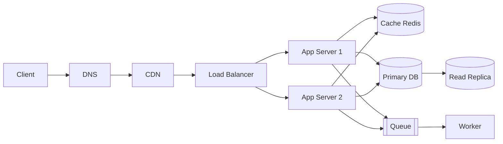

# QuickNotes System Architecture

This document describes the high-level system architecture, requirements, load estimates, component descriptions, request lifecycles, and architectural trade-offs for the QuickNotes application.

---

## 1. Requirements

### Functional Requirements
* **Account Registration & Login:** Users can securely create accounts, log in with credentials, and obtain authentication tokens.
* **CRUD Notes:** Users can create, read, update, and delete their own notes.
* **Tag Notes:** Users can create tags and associate multiple tags with notes for categorization.
* **Search Notes:** Users can search and filter notes by keywords in titles, bodies, and assigned tags.
* **Share Notes:** Users can share notes with other registered users or generate read-only access links.

### Non-Functional Requirements
* **High Availability:** Target 99.9% uptime (~8.76 hours maximum allowable downtime per year).
* **Latency:** p95 read latency < 200 ms; p95 write latency < 500 ms.
* **Security:** Enforce HTTPS/TLS in transit, bcrypt password hashing, parameterized database queries, and role-based resource access control.
* **Scalability:** System architecture capable of horizontally scaling to support 1,000,000 daily active users (DAU).

---

## 2. Capacity & Load Estimation

### Assumptions
* **Daily Active Users (DAU):** 1,000,000 users.
* **Daily Read Activity:** 20 note reads per user per day.
* **Daily Write Activity:** 2 note writes per user per day.
* **Average Note Size:** 1 KB text content.

### Calculations
* **Total Daily Reads:** $1,000,000 \times 20 = 20,000,000\text{ reads/day}$
* **Average Reads/Sec:** $20,000,000 \div 86,400\text{ sec} \approx 232\text{ reads/s}$
* **Peak Reads/Sec (3× multiplier):** $232 \times 3 \approx 700\text{ reads/s}$
* **Total Daily Writes:** $1,000,000 \times 2 = 2,000,000\text{ writes/day}$
* **Average Writes/Sec:** $2,000,000 \div 86,400\text{ sec} \approx 23\text{ writes/s}$
* **Peak Writes/Sec (3× multiplier):** $23 \times 3 \approx 70\text{ writes/s}$
* **Annual Storage Growth:**
  $$2\text{ notes/day} \times 1\text{ KB} \times 1,000,000\text{ users} \times 365\text{ days} \approx 730\text{ GB/year}$$
* **Provisioning Target:** Factoring in indexes, relational metadata, and database overhead (~35%), provision **~1 TB/year**.

---

## 3. High-Level Architecture Diagram

---

## 4. Component Descriptions

1. **Client (Web/Mobile App):** Solves the user interaction problem by providing an intuitive interface to read, compose, edit, and organize notes.
2. **DNS (Domain Name System):** Solves hostname resolution by mapping application domain names to edge IPs and routing client traffic to the nearest CDN point of presence.
3. **CDN (Content Delivery Network):** Solves geographic latency and origin offloading by caching and serving static web assets (HTML, CSS, JS, images) closest to the user.
4. **Load Balancer (Reverse Proxy):** Solves traffic overload and single-point-of-failure vulnerabilities by terminating TLS and distributing incoming API requests across healthy application servers.
5. **App Servers (App Server 1 & 2):** Solve business logic processing by authenticating requests, validating inputs, executing note operations, and orchestrating database/cache access.
6. **Cache (Redis):** Solves database read bottlenecks and latency by storing active user sessions and frequently queried note lists directly in memory.
7. **Primary DB (PostgreSQL Primary):** Solves data persistence and transactional integrity by processing all write operations with strict ACID compliance.
8. **Read Replica (PostgreSQL Replica):** Solves database read contention by serving read-heavy note listing queries through asynchronous replication from the primary.
9. **Queue (Message Broker / RabbitMQ):** Solves write blocking and request latency by buffering asynchronous background workloads such as search indexing and notifications.
10. **Worker:** Solves background execution bottlenecks by consuming queued tasks and processing compute-heavy jobs asynchronously without delaying client HTTP responses.

---

## 5. Request Lifecycles

### GET /notes Flow (Read Path)
1. **Request Initiation:** The Client initiates an authenticated `GET /notes` request to fetch the user's note list.
2. **DNS Lookup:** DNS resolves the API domain name to the nearest CDN edge server.
3. **CDN Edge Check:** The CDN intercepts the request; identifying an authenticated dynamic API call, it records a cache bypass/miss and forwards the request to the Load Balancer.
4. **Load Balancing:** The Load Balancer inspects server health and routes the request to an available App Server instance.
5. **Auth & Cache Lookup:** The App Server validates the authorization token and queries the Redis Cache for the user's note collection.
6. **Cache Evaluation:**
   * **Cache Hit:** The App Server retrieves the serialized note list from Redis and skips database querying.
   * **Cache Miss:** The App Server issues a read query (`SELECT`) to the PostgreSQL Read Replica.
7. **Cache Population:** On a cache miss, the App Server writes the newly fetched notes into Redis with a short time-to-live (TTL).
8. **Client Response:** The App Server formats the note records as JSON and returns an HTTP `200 OK` response to the Client.

### POST /notes Flow (Write Path)
1. **Submission:** The Client submits a `POST /notes` request containing the note title, body, and tags.
2. **Load Balancing:** The Load Balancer terminates TLS and forwards the write request to an available App Server.
3. **Validation & Auth:** The App Server validates user credentials and verifies input constraints (e.g., verifying title presence and length $\le$ 100 characters).
4. **Primary Database Write:** The App Server executes an ACID transaction writing the note and junction records into the PostgreSQL Primary Database.
5. **Cache Invalidation:** The App Server invalidates or refreshes the user's cached notes list in Redis to ensure subsequent reads reflect the update.
6. **Enqueue Asynchronous Tasks:** The App Server pushes a background job (e.g., full-text search indexing, tag aggregations) into the Message Queue.
7. **Client Response:** The App Server returns an HTTP `201 Created` status with the newly created note JSON payload.
8. **Asynchronous Execution:** A background Worker consumes the job from the Message Queue and updates the search index asynchronously.

---

## 6. Architecture Trade-offs & SPOF Mitigations

### Trade-off 1: Read Replica Lag vs. Fast Reads
* **Trade-off:** Utilizing asynchronous replication to PostgreSQL read replicas keeps p95 read latencies low (< 200 ms) and protects the primary from high read traffic. However, replication lag introduces the risk of stale reads where a user does not immediately observe a note they just authored.
* **Mitigation & SPOF Handling:**
  * *Consistency Mitigation:* Implement a "read-your-own-writes" policy where recent writes populate the Redis cache immediately, or subsequent queries within a brief time window route directly to the primary database.
  * *SPOF Mitigation:* A database outage is prevented by configuring a Multi-AZ Primary with a synchronous standby and automated health check failover, guaranteeing that primary hardware failures trigger zero-data-loss failovers.

### Trade-off 2: Queue Asynchronous Processing vs. Immediate Consistency
* **Trade-off:** Offloading search index generation and auxiliary tasks to a message queue decouples write requests and guarantees p95 write latencies under 500 ms. The trade-off is eventual consistency, meaning a note might not appear in search queries for several hundred milliseconds.
* **Mitigation & SPOF Handling:**
  * *Consistency Mitigation:* Accept eventual consistency for search indexing because note authoring and list viewing are satisfied immediately via the database and cache.
  * *SPOF Mitigation:* Single points of failure in the queue and worker tiers are mitigated by running a clustered message queue spanning multiple availability zones and deploying $\ge 2$ redundant worker instances with automatic job acknowledgments and dead-letter queue retries.
